<!-- SPIDER-VERSE profile · cinematic developer portfolio -->

<!-- Hero first — no letterboxed nav strip above -->

  

<!-- Clickable anchors + identity badges sit flush under the hero -->

  <a href="#origin">ORIGIN</a>
  &nbsp;·&nbsp;
  <a href="#powers">POWERS</a>
  &nbsp;·&nbsp;
  <a href="#multiverse">MULTIVERSE</a>
  &nbsp;·&nbsp;
  <a href="#activity">ACTIVITY</a>

  
  
  

  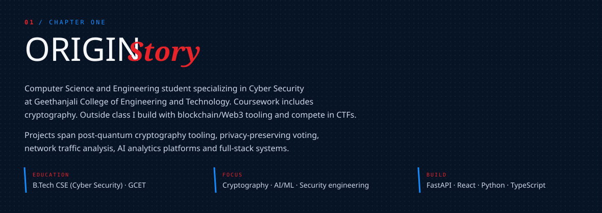

  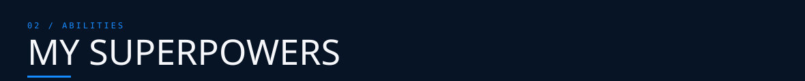

<table>
  <tr>
    <td width="33%">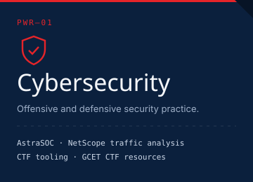</td>
    <td width="33%">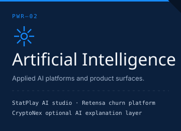</td>
    <td width="33%">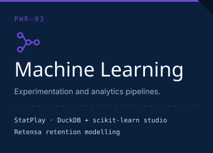</td>
  </tr>
  <tr>
    <td width="33%">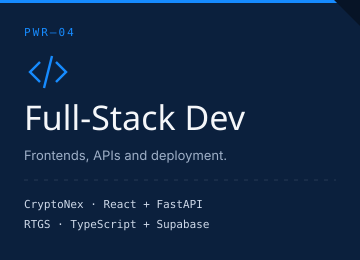</td>
    <td width="33%">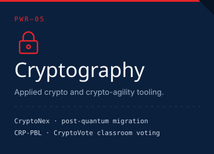</td>
    <td width="33%">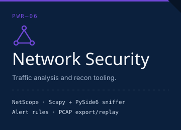</td>
  </tr>
</table>

  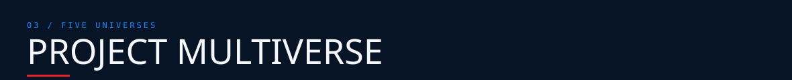

<table>
  <tr>
    <td width="50%">
      <a href="https://github.com/kakumanuharshithsubrahmanyam-wq/CryptoNex">
        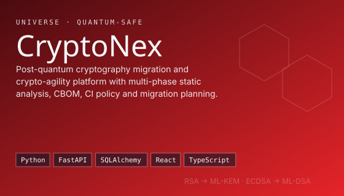
      </a>
    </td>
    <td width="50%">
      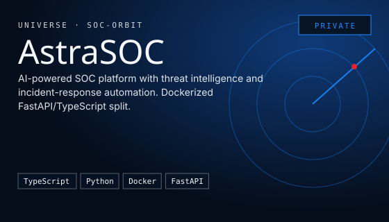
    </td>
  </tr>
  <tr>
    <td width="50%">
      <a href="https://github.com/kakumanuharshithsubrahmanyam-wq/statplay-ai">
        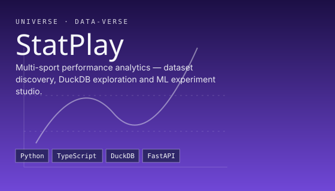
      </a>
    </td>
    <td width="50%">
      <a href="https://github.com/kakumanuharshithsubrahmanyam-wq/CustomPacketSniffer">
        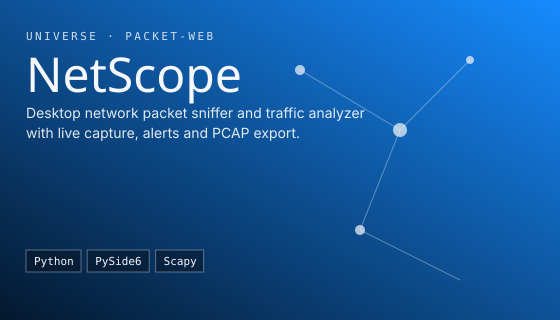
      </a>
    </td>
  </tr>
  <tr>
    <td colspan="2" align="center">
      <a href="https://github.com/kakumanuharshithsubrahmanyam-wq/DecodeX-Final-Project">
        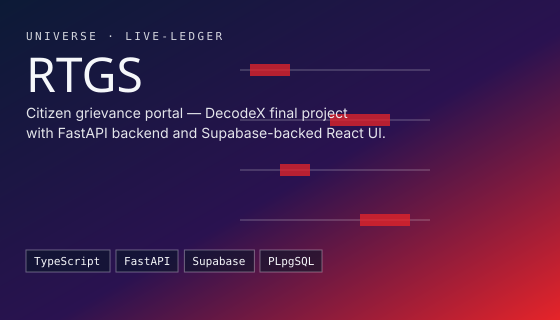
      </a>
    </td>
  </tr>
</table>

  <b><a href="https://github.com/kakumanuharshithsubrahmanyam-wq/CryptoNex">CryptoNex</a></b> — AI-powered post-quantum cryptography migration and crypto-agility platform 
  <b>AstraSOC</b> <code>private</code> — AI-powered SOC with threat intelligence and incident-response automation (no public repository link) 
  <b><a href="https://github.com/kakumanuharshithsubrahmanyam-wq/statplay-ai">StatPlay</a></b> (<code>statplay-ai</code>) — Multi-sport performance analytics: discovery, DuckDB exploration, ML studio 
  <b><a href="https://github.com/kakumanuharshithsubrahmanyam-wq/CustomPacketSniffer">NetScope</a></b> (<code>CustomPacketSniffer</code>) — Desktop network packet sniffer and traffic analyzer 
  <b><a href="https://github.com/kakumanuharshithsubrahmanyam-wq/DecodeX-Final-Project">RTGS</a></b> (<code>DecodeX-Final-Project</code>) — RTGS grievance portal — DecodeX final project

  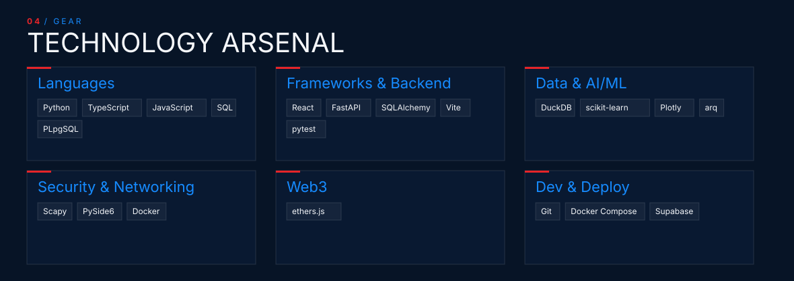

  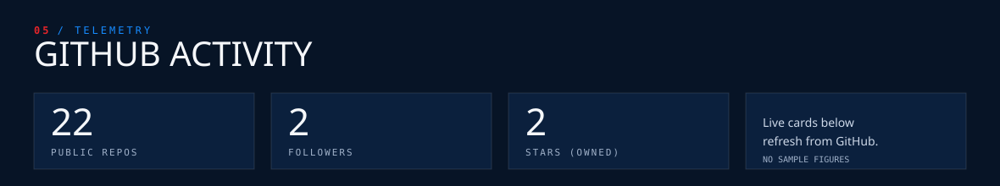
  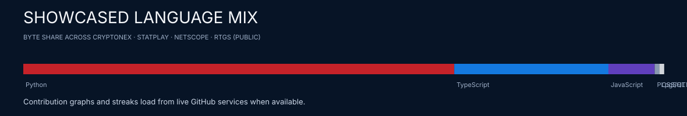

  
  

<!-- Live third-party cards. Local overview above remains visible if these services are down. -->

  
  

  

  <a href="https://github.com/kakumanuharshithsubrahmanyam-wq">
    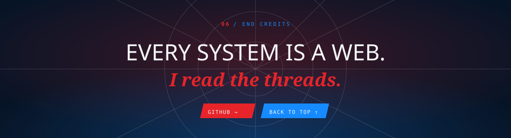
  </a>
  

    <a href="https://github.com/kakumanuharshithsubrahmanyam-wq">GitHub</a>
    ·
    <a href="https://github.com/kakumanuharshithsubrahmanyam-wq?tab=repositories">Repositories</a>
    ·
    <a href="#top">Back to top</a>
  

  
HARSHITH SUBRAHMANYAM KAKUMANU · SPIDER-VERSE PROFILE

